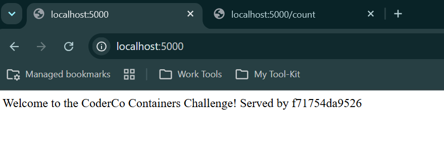
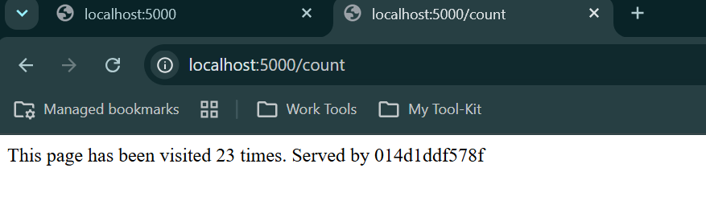
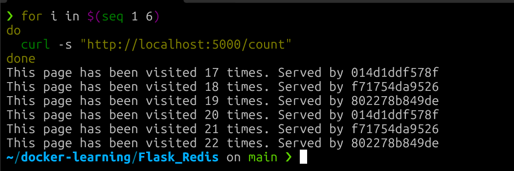
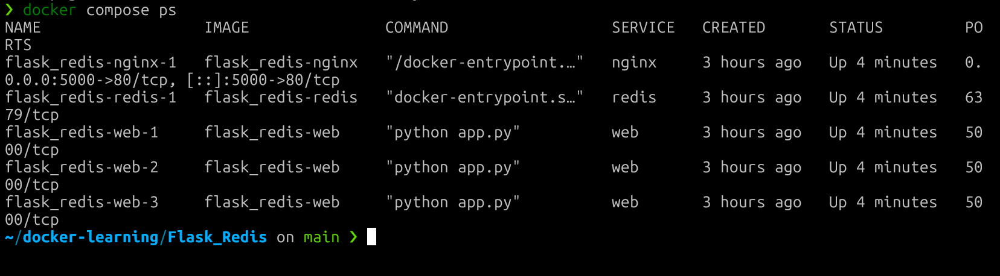

# 05 - Docker

# Containers, Compose, Registries and Load Balancing

This module took me from running my first container to building and troubleshooting multi-container applications.

Rather than only following along with the videos, I built two projects, pushed images to both Docker Hub and Amazon ECR, and spent a lot of time working out why things broke. Most of what I learned came from the troubleshooting.

The code for both projects lives in my [docker-learning](https://github.com/zeezmann/docker-learning) repository. This page documents what I built, how I approached it and what I learned.

---

# What I Learned

- Containers vs virtual machines
- Images, layers and how layer caching works
- Writing Dockerfiles and ordering steps so rebuilds stay fast
- Running, tagging and managing containers
- Port mapping and why only one container can bind a host port
- Docker networking and Docker's built-in DNS
- Docker Compose for multi-container applications
- Named volumes vs anonymous volumes
- Environment variables for configuration
- Pushing and pulling images from Docker Hub and Amazon ECR
- Image architectures (arm64 vs amd64) on Apple Silicon
- Multi-stage builds and image size
- Load balancing with nginx as a reverse proxy
- How containers handle shutdown signals, and what exit codes 137 and 143 mean
- `.dockerignore` and keeping images clean

---

# Technologies Used

| Technology | Purpose |
|------------|---------|
| Docker | Building and running containers |
| Docker Compose | Running multi-container applications |
| Python / Flask | Web applications |
| MySQL | Database for the Flask_App project |
| Redis | Key-value store for the visit counter |
| nginx | Reverse proxy and load balancer |
| Docker Hub | Public image registry |
| Amazon ECR | Private image registry in AWS (`eu-west-2`) |
| AWS CLI | Authenticating Docker with ECR |
| Git / GitHub | Version control, pull requests and documentation |

---

# Intro Tasks

| Task | What I did |
|------|------------|
| Install Docker | Docker on WSL (Ubuntu 24.04) and Docker Desktop on my Apple Silicon MacBook |
| Create a Dockerfile | Containerised a Flask application |
| Build and run | Built images and ran them locally with port mapping |
| Push to Docker Hub | Tagged and pushed `zeezmann/flask-app` |
| Basic Compose | Ran Flask with MySQL as a two-service Compose stack |

I also pushed the same image to a private Amazon ECR repository, then pulled it back and ran it, to understand how private registries and AWS authentication work.

---

# Project 1: Flask + MySQL

[View the code](https://github.com/zeezmann/docker-learning/tree/main/Flask_App)

A Flask app connected to a MySQL database, run with Docker Compose. The app reaches the database using its Compose service name, `db`, and returns the MySQL version.

```
Hello, World! MySQL version: 5.7.44
```

What I did with it:

- Built and ran it with Compose
- Pushed it to Docker Hub and Amazon ECR, then ran the stack from the ECR image
- Ran the app container separately from MySQL on a custom Docker network to understand container DNS
- Built a multi-stage version to compare image sizes

| Image | Disk usage | Content size |
|-------|------------|--------------|
| Single-stage | 619 MB | 156 MB |
| Multi-stage | 372 MB | 88.4 MB |

The multi-stage build keeps compilers like `gcc` out of the final image, while still including the runtime library the MySQL driver needs.

I later rebuilt the main Flask_App image as a multi-stage build on Python 3.12 with only the runtime library in the final stage, which brought it down to 202 MB on disk and 49.5 MB content.

---

# Project 2: CoderCo Containers Challenge

[View the code](https://github.com/zeezmann/docker-learning/tree/main/Flask_Redis)

A Flask visit counter backed by Redis. I completed the core challenge and all three bonuses: persistent storage, environment variables, and scaling with a load balancer.

## Architecture

```
                localhost:5000
                      │
                      ▼
             nginx (load balancer)
           ┌──────────┼──────────┐
           ▼          ▼          ▼
         web-1      web-2      web-3
           └──────────┼──────────┘
                      ▼
                    Redis
                      │
              redis-data volume
```

- nginx is the only service published to the host
- The Flask app runs as 3 replicas, set in the Compose file
- Redis isn't published to the host. Only the Flask containers can reach it, over the Compose network
- A named volume keeps the count when containers are removed and recreated

### Welcome Page



### Visit Counter



### Load Balancing Across 3 Containers

Each request returns the ID of the container that served it. The count is shared because every replica uses the same Redis.



### Running Services



## How My Solution Compared to the Course Solution

After finishing, I compared my solution with CoderCo's. The main differences:

- I didn't publish the Redis port to the host, since only the Flask containers need to reach it
- I pinned image tags and Python library versions instead of using `:latest`
- I installed dependencies before copying the app code, so code changes don't re-run `pip install`
- I set the replica count in the Compose file instead of using `--scale`, so the intended setup lives in Git
- I baked the nginx config into its own image instead of bind-mounting it, so the image is self-contained

---

# Troubleshooting

## Stale Image in ECR

### Problem

Running the Flask_App stack from my ECR image failed with `Unknown server host 'mydb'`, even though my code connected to `db`.

### Cause

The `latest` image in ECR had been built in August from an older version of the code that still used `mydb`. My source in Git had moved on, but the image hadn't been rebuilt.

### Resolution

I confirmed it by running `grep` inside the image, which showed `host="mydb"` baked in. I rebuilt from the current source, tagged the image with both `latest` and the Git commit hash, tested the stack locally, then pushed to ECR and checked that the digests matched.

I considered renaming the Compose service to `mydb` instead, but that would have meant changing correct config to match a broken image. Git is the source of truth, so I fixed the image.

---

## Local Files Copied Into the Image

### Problem

Listing the contents of `/app` inside my Flask_App image showed my local `.venv` folder, the Dockerfile, `.gitignore` and `docker-compose.yml`, none of which the app needs.

### Cause

The Dockerfile used `COPY . .` and there was no `.dockerignore`. Docker doesn't read `.gitignore`, so everything in the folder went into the image.

### Resolution

I added a `.dockerignore`, changed the Dockerfile to copy only `app.py`, and confirmed the new image contains nothing else in `/app`.

---

## MySQL Image Not Running on Apple Silicon

### Problem

The MySQL 5.7 image wouldn't run on my M-series MacBook.

### Cause

MySQL 5.7 doesn't publish an arm64 image, only amd64.

### Resolution

I added `platform: linux/amd64` for the MySQL service on my Mac, so Docker runs the amd64 image through emulation. I used `--platform linux/amd64` in the same way to run my amd64 ECR image on the Mac.

---

## Container Couldn't Find the Database

### Problem

Running the Flask container on its own, outside Compose, failed because it couldn't resolve the database hostname.

### Cause

Containers on Docker's default network can't look each other up by name.

### Resolution

I created a custom Docker network and attached both containers to it. User-defined networks include Docker's DNS, so the app could reach the database by container name. Compose does this automatically, which is why the hostname works inside a Compose stack.

---

## Multi-Stage Image Missing a Runtime Library

### Problem

My first multi-stage image was much smaller, but failed when it ran.

### Cause

I had removed the build tools from the final stage, but also removed a library the MySQL driver needs at runtime.

### Resolution

I added the MySQL client library to the runtime stage, and checked the result by confirming `gcc` wasn't in the final image and that the MySQL driver imported successfully.

---

## Scaling Failed With "Port Already Allocated"

### Problem

Scaling the Flask service to 3 containers failed with `Bind for 0.0.0.0:5000 failed: port is already allocated`. One container ran, and the other two were created but never started.

### Cause

Every replica was trying to publish host port 5000, and only one process can bind a port.

### Resolution

I removed the port mapping from the Flask service and put nginx in front as a load balancer. nginx is now the only service publishing port 5000, and it spreads requests across the replicas over the Compose network.

---

## Visit Count Reset After `docker compose down`

### Problem

After `docker compose down` and `up`, the visit count went back to 1.

### Cause

The Redis image gives each container an anonymous volume. When `down` removed the container, its volume was left behind, and the new container got a brand new empty one. Running `docker volume ls` before and after showed the new random-named volume appear.

### Resolution

I added a named volume. Compose finds it by name every time, so new containers reattach to the same data.

---

## Containers Taking 10 Seconds to Stop

### Problem

Stopping the Flask containers took around 10 seconds and they exited with code 137.

### Cause

Exit code 137 means the process was killed with `SIGKILL`. Inside a container, the app runs as PID 1, and Linux ignores signals that PID 1 hasn't set up a handler for. Python doesn't handle `SIGTERM` by default, so Docker's request to stop was ignored until it timed out and killed the process.

### Resolution

I added `init: true` to the Flask services, which runs a small init process that passes signals on. The containers now stop in under a second with exit code 143, which means they shut down on `SIGTERM` as intended.

---

## ECR Delete Permission Denied

### Problem

Deleting the old image from ECR failed with `AccessDeniedException`.

### Cause

My IAM user is allowed to push and pull images but not delete them. The error said no policy allowed the action, which is an implicit deny, not an explicit one blocking it.

### Resolution

The old image costs pennies to store, so I left it rather than widening my permissions. It was a useful lesson in reading IAM errors and in least privilege. I'll set up proper admin access during the AWS module.

---

# Useful Commands

## Images and Containers

```bash
docker build -t name:tag .
docker images
docker ps -a
docker logs <container> --tail 20
docker exec -it <container> sh
docker run --rm <image> <command>
docker image inspect <image> --format '{{.Created}} {{.Architecture}}'
```

## Compose

```bash
docker compose config
docker compose up -d --build
docker compose ps
docker compose logs <service>
docker compose stop
docker compose down
```

## Volumes and Networks

```bash
docker volume ls
docker volume inspect <volume>
docker network ls
```

## Amazon ECR

```bash
docker push --all-tags <repository-uri>
aws ecr describe-images --repository-name <repo> --region eu-west-2
```

I use the Amazon ECR credential helper, so Docker gets a fresh ECR token from my AWS CLI credentials automatically and doesn't store one on disk.

---

# Lessons Learned

- An image is a snapshot of the code at the time it was built. If the code changes and the image isn't rebuilt, they drift apart. Tagging images with the commit hash makes it obvious what's inside.
- Prove the cause before fixing it. Checking inside the image before rebuilding meant I fixed the right thing.
- Docker doesn't read `.gitignore`. Without a `.dockerignore`, `COPY . .` copies everything in the folder into the image.
- "Started" isn't the same as "ready". `depends_on` and port mappings can be up before the app inside is listening.
- Only publish the ports that need to be reached from outside. Services that only talk to each other can stay on the internal network.
- Untagged doesn't mean unused. Some untagged images in ECR were parts of my current image, so I checked the manifest before deleting anything.
- Put the intended setup in files that live in Git, not in commands someone has to remember.
- Error messages and exit codes usually tell you exactly what went wrong if you read them properly.

---

# Next Steps

- AWS
- Terraform & IaC
- CI/CD Pipelines
- Kubernetes
- Projects
